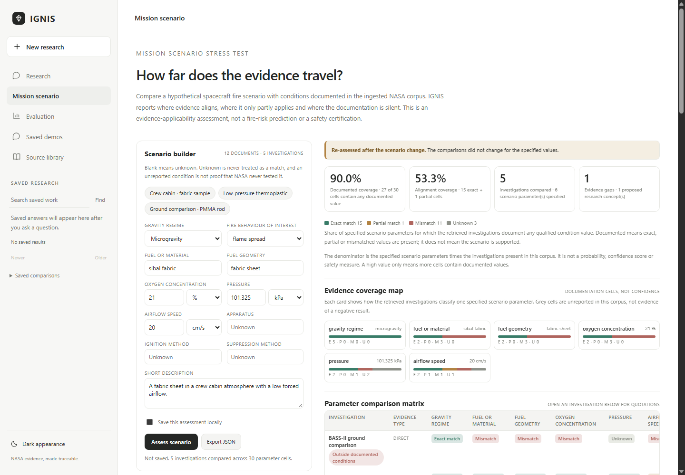
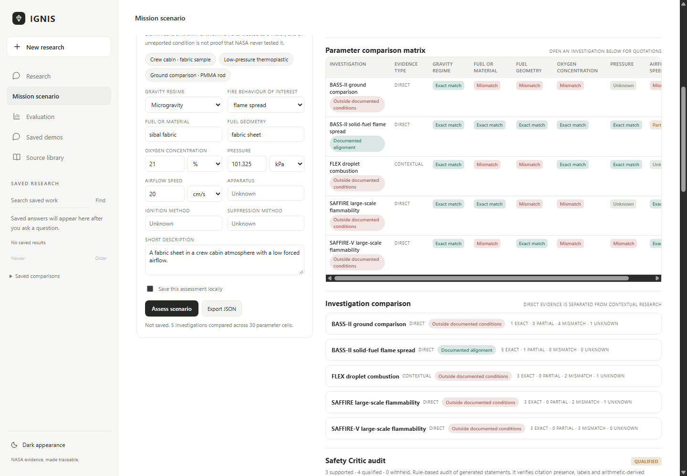
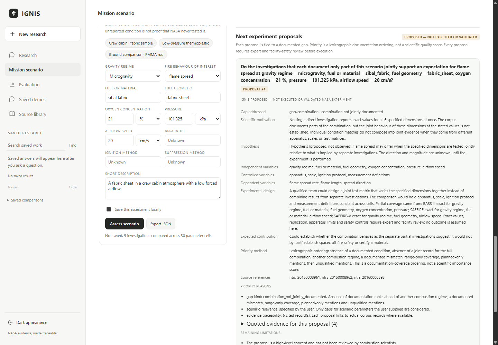
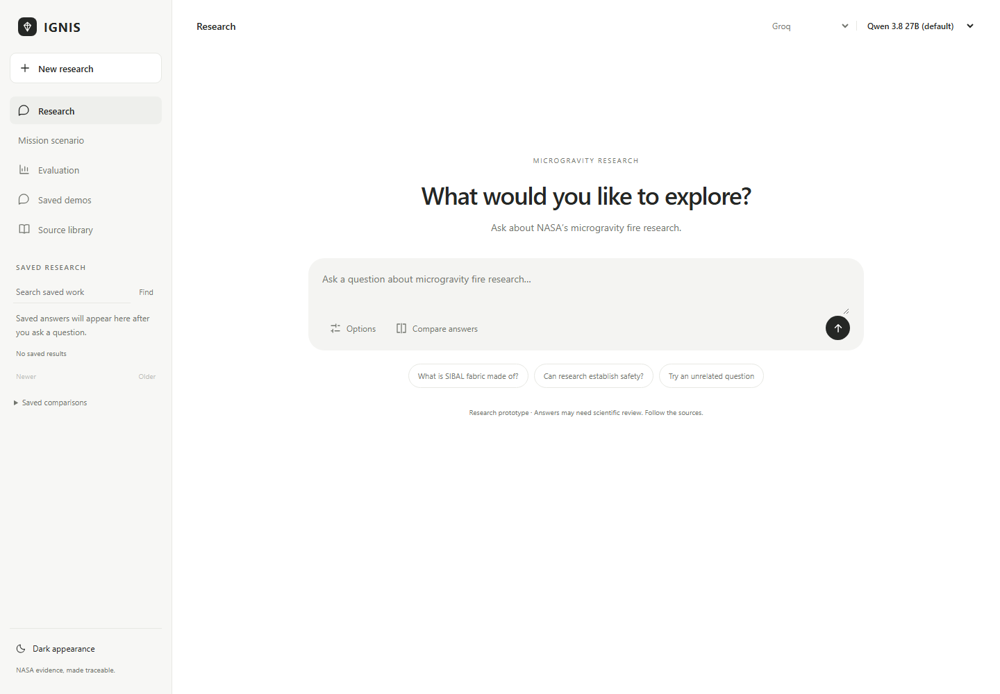

# AXIOM

**Evidence-grounded intelligence for spacecraft fire safety.**

AXIOM turns NASA microgravity combustion literature into a traceable research
workspace: every scientific statement is tied to a located source passage, every
scenario comparison exposes what the corpus does and does not document, and
every proposed experiment is explicitly marked as not executed.

> **Deployment status:** no public instance is claimed. The application was
> verified locally at `http://127.0.0.1:8767`; container and local deployment
> steps are documented in [docs/DEPLOYMENT.md](docs/DEPLOYMENT.md). A free-tier
> Render split (static frontend plus Python API) is prepared and locally tested
> but **not deployed**; see
> [docs/RENDER_DEPLOYMENT.md](docs/RENDER_DEPLOYMENT.md). No benchmark accuracy,
> adoption or safety-certification claim is made anywhere in this repository.

---

## The scientific problem

Fire behaves differently without buoyancy. On Earth, hot gas rises and carries
oxygen to a flame; in microgravity there is no buoyant flow, so flames spread by
diffusion and low-speed forced convection, can burn at oxygen concentrations and
airflows that would extinguish a terrestrial flame, and can transition to
cool-flame or smouldering behaviour. Spacecraft cabins add a second constraint:
the crew cannot evacuate, so material selection, ventilation design and
suppression strategy must rest on evidence rather than terrestrial intuition.

NASA has studied these effects for decades — BASS-II, FLEX and the Saffire
series among them — but the evidence is spread across technical reports,
conference papers and presentations. Important details are buried in test
tables, and many published statements describe one apparatus, one gravity
regime or one oxygen/flow combination. Reading a conclusion without its test
conditions is a known route to over-generalisation.

## Why it matters for human space exploration

A fire-safety decision for a crewed vehicle needs three things that ordinary
literature search does not provide:

1. **Located evidence** — the exact passage behind a number or conclusion.
2. **Condition awareness** — the gravity, oxygen, pressure, airflow, fuel and
   geometry under which that evidence was obtained.
3. **Honest absence** — a clear statement when the available corpus does not
   document a condition, instead of an implied yes.

AXIOM is built around those three requirements. It does not predict fire risk
and it does not certify materials.

## How AXIOM solves it

- **Retrieval with provenance.** 294 passages from 12 ingested NASA documents
  are indexed with source identifiers, chunk identifiers, page locators and
  SHA-256 digests. Search results and claim citations point back to the passage.
- **Claim checking (Safety Critic).** A deterministic critic checks each drafted
  claim for quotation validity, numeric literals without citations, unresolved
  units and experimental-scope overreach, and withholds what it cannot support.
  Model calls are optional; the critic itself is not a model.
- **Mission Scenario Stress Test.** A hypothetical spacecraft fire scenario is
  compared against documented test conditions with four fixed classifications.
- **Next Experiment Planner.** Documentation gaps become at most three research
  proposals with traceable motivation, explicit variables and a
  `PROPOSED — NOT EXECUTED` label.
- **No invented confidence.** Coverage is reported as documented coverage and
  alignment coverage, both defined arithmetically over scenario × investigation
  cells. There is no aggregate confidence or fire-risk score.

## Mission Scenario Stress Test

Open **Mission scenario** in the dashboard, load the **Crew cabin · fabric
sample** preset, then change oxygen, pressure or airflow. The assessment
re-runs locally and shows:

- a matrix of every specified parameter against every investigation, classified
  as **exact match**, **partial match**, **mismatch** or **unknown**;
- the quoted passage, document identifier, chunk identifier and page locator
  behind each classification;
- documented coverage and alignment coverage as separate numbers;
- evidence gaps, including *no single investigation documents the full
  combination*;
- a deterministic Safety Critic audit of the generated text;
- a change diff against the previous assessment.

**Unknown never becomes a match.** A blank scenario field stays unknown, and an
unreported condition is described as *not documented in this corpus*, never as
*NASA never tested it*. Matching uses exact equality after unit conversion,
explicit categorical aliases and containment in a reported test range. No
similarity threshold or model judgement is used.

## AXIOM runtime assurance

AXIOM adds deterministic condition applicability, a three-valued monitor over
versioned execution traces, and a seeded trace-mutation lab. The monitor checks
whether its recorded process is trustworthy; it does not decide whether a
scientific source semantically supports an answer. The applicability result is
a necessary documented-scope check, not proof of physical transferability.
Open **AXIOM assurance** for saved evaluation and validation results, or use the
demo presets to mutate one recorded trace in memory.

AXIOM measurements are file-backed. An absent result file is shown as “not run.”
The recorded 36-question three-arm comparison has two execution failures and no
independent scientific answer grades. Semantic correctness metrics remain null;
the report describes abstention, answer coverage, claim retention and monitor
behavior without claiming an accuracy improvement. See
[formal property semantics](docs/FORMAL_PROPERTIES.md),
[mutation results](docs/TRACE_MUTATIONS.md),
[metadata validation](docs/METADATA_VALIDATION.md),
[evaluation](docs/EVALUATION.md), and [research motivation](docs/RESEARCH_MOTIVATION.md).

## Next Experiment Planner

The planner derives gaps from the same comparison and produces one to three
candidate experiments. Each proposal includes a research question, a hypothesis
explicitly marked as proposed and not observed, independent, controlled and
dependent variables, an experimental design sketch, expected contribution,
source-linked scientific motivation and unresolved limitations.

Ordering is **lexicographic documentation-based**: absent documentation ranks
ahead of another combustion regime, a documented mismatch, range-only coverage,
planned-only mentions and unqualified mentions. It is a documentation ordering,
not a scientific-importance score. The planner never invents a numeric range,
measurement, sample size or outcome, and the scenario values it reuses are
labelled `user_scenario_value_not_measured`.

## System architecture

```text
Browser (single-page dashboard, no build step)
        │  same-origin JSON over HTTP
        ▼
src/axiom/server.py        standard-library threaded HTTP service
        │                  host allow-list, origin check, /healthz
        ├── research.py / retrieval.py      evidence retrieval and ranking
        ├── critic.py                       deterministic claim checking
        ├── experiment_metadata.py          quoted condition extraction
        ├── transferability.py              comparison, coverage, gaps, proposals
        ├── scenario.py                     assessment orchestration and presets
        ├── run_records.py                  atomic JSON persistence
        └── providers.py                    optional Groq / OpenRouter / Ollama / extractive
        │
        ▼
data/processed/chunks.jsonl   294 passages with locators and hashes
data/sources.json             19-entry NASA source inventory and rights
runs/scenarios/               saved scenario JSON snapshots
```

The dashboard is one HTML file with no framework or package-manager build. It is
served by the Python process by default, which keeps a judge's setup to one
install command. It can also be copied to a static host with a generated
`config.js` naming the API origin; `scripts/render_static_config.mjs` performs
that copy for the prepared Render blueprint.

## NASA data sources

The ingested core corpus contains **12 NASA documents** and **294 passages**.
All 12 are recorded as public-use permitted in `data/sources.json`. The
investigations represented are **BASS-II**, **FLEX** and **SAFFIRE**
(including Saffire V material), plus a BASS-II ground-comparison paper.

Three further NTRS records in the inventory are `review_required` and are **not
ingested or redistributed**. Raw PDF bytes are not shipped; the processed
passages, locators, hashes and original URLs are. Full per-source attribution,
rights and extraction limitations are in
[docs/DATA_SOURCES.md](docs/DATA_SOURCES.md) and
[THIRD_PARTY_NOTICES.md](THIRD_PARTY_NOTICES.md).

## Technology stack

| Layer | Choice |
|---|---|
| Language | Python 3.12+ |
| HTTP service | Python standard library (`http.server`) |
| Dashboard | Hand-written HTML, CSS and JavaScript; inline SVG; no framework or CDN |
| Corpus format | JSON Lines plus JSON manifests and SHA-256 integrity checks |
| PDF ingestion | `pypdf==6.13.0` (pinned; wheel bundled) |
| Optional models | Groq, OpenRouter, local Ollama, or offline extractive mode |
| Persistence | Atomic JSON snapshots under `runs/scenarios/` |
| Packaging | `setuptools`, `pyproject.toml`, bundled wheelhouse |

## Installation

Python 3.12 or newer is required. From the repository root:

```bash
python -m venv .venv
```

Windows:

```powershell
.\.venv\Scripts\python.exe -m pip install --no-index --find-links wheelhouse -e .
```

Linux / macOS:

```bash
.venv/bin/python -m pip install --no-index --find-links wheelhouse -e .
```

The wheelhouse install is offline. If you prefer PyPI, `pip install -e .` also
works and installs the same pinned dependency.

## Running

```bash
python -m axiom serve --port 8767
```

Then open **http://127.0.0.1:8767**.

No API key, model download or network connection is needed for the corpus
search, the Mission Scenario Stress Test, the Next Experiment Planner or the
three saved demonstration replays. Live model answers are optional: copy
`.env.example` to `.env`, add `GROQ_KEY` or `OPENROUTER_KEY`, and select the
provider in the dashboard.

On Windows, `launch.ps1` (or double-clicking `launch.cmd`) creates the virtual
environment, installs from the wheelhouse and starts the dashboard on port
8767.

With Docker:

```bash
docker compose up --build
```

Saved scenarios persist in the `axiom_scenarios` named volume. See
[docs/DEPLOYMENT.md](docs/DEPLOYMENT.md) for host configuration, health checks
and reverse-proxy notes, and
[docs/RENDER_DEPLOYMENT.md](docs/RENDER_DEPLOYMENT.md) for the free-tier split
and its ephemeral-storage limits.

## Documentation

The documentation map is [docs/INDEX.md](docs/INDEX.md). Dated phase-status and
roadmap notes are archived under [docs/history/](docs/history/README.md) for
provenance; current behaviour is described by the documents linked from the
index.

## Screenshots

| Mission Scenario | Evidence matrix |
|---|---|
|  |  |

| Next Experiment Planner | Research workspace |
|---|---|
|  |  |

## Scientific limitations

- Condition metadata is **machine-extracted** from text and tables and is **not
  human-reviewed**. Extraction can miss values, especially in complex tables.
- The corpus contains **12 documents**. It is not the complete NASA archive.
  Absence of a condition is not evidence that the condition was never tested.
- Matching is exact equality after unit conversion or containment in a reported
  range. Range membership is not experimental equivalence.
- Condition comparison is necessary but not sufficient for transferability:
  apparatus, scale, ignition protocol and measurement definitions can still
  differ.
- The Safety Critic reduces unsupported text; it does not establish truth.
- Evaluation counts in this repository are **observed decisions**, not
  scientific accuracy. Independent scientific grading is absent.
- The three scenario presets are synthetic demonstrations, not mission
  specifications. No fire-risk score, probability or safety certification is
  produced.
- Every proposed experiment is a concept that requires qualified combustion
  science and facility-safety review before execution.

See [docs/SAFETY_AND_LIMITATIONS.md](docs/SAFETY_AND_LIMITATIONS.md).
